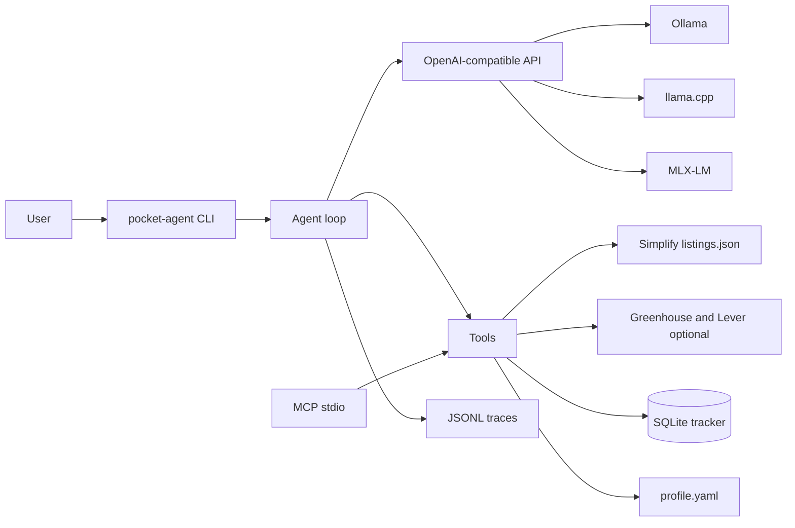

# Pocket Agent

Repository: [github.com/linnkhant07/pocket_agent](https://github.com/linnkhant07/pocket_agent). The Python package and the `pocket-agent` command keep the hyphen. The GitHub repo name is `pocket_agent`.

Pocket Agent is a free, MIT-licensed recruiting assistant that runs on your machine. Version 1 fills a job application in a local browser and stops before submit. It also reads public job lists, scores them against a local `profile.yaml`, and keeps an application tracker in SQLite.

It does not submit applications. There is no apply tool, and `pocket-agent fill` will not click Submit.

## Form filler

`pocket-agent fill <url>` opens the page in Chromium, reads every field it can see, and fills the ones that match the local profile. Anything it does not know, and anything on the always-ask list, it asks in the terminal and stores the answer. Saved answers are reused only when the question is the same fact. "Authorized to work" is not "requires sponsorship."

Always asked, unless you already saved an explicit "always use this" answer: essays and cover letters, salary, start date, spoken languages and interview language, export-control and government or conflict-of-interest questions, "will you have finished your degree" and graduation-window checks, hybrid or on-site schedule and office choice, EEO (gender, Hispanic/Latino, race, veteran, disability), e-signature, certification, and arbitration checkboxes. By default passwords are not typed and a sign-in page stops the run. Opt-in Workday account support is described below. CAPTCHA and email verification are handed to you in the browser.

The page reader is ordinary code. It uses the label, `aria-label`, `aria-labelledby`, and nearby text. It handles text, text areas, native selects, radio groups, checkboxes, dates, file upload, ARIA comboboxes, and typeahead lists. Multi-step pages advance with Next or Continue. A button is not clicked when it submits, when it says Submit, Apply, or Finish, when it says Continue on a Review step, or when the page says it is the last step (`Step 3 of 3`). Resume parse mistakes are overwritten from the profile. The command prints what it filled, what it asked, and what it skipped.

Memory is `~/.pocket-agent/forms.sqlite`. Matching tries canonical synonyms, then a fuzzy match, then a local GGUF model. The model is only allowed to return JSON, and a fill must be one of the memory values it was shown. If the model file is missing, known fields still fill and unknown fields are asked.

This was tested on Linux, not on a Mac. The reader and the form suite do not use a GPU. Apple Silicon is the machine the filler is aimed at; Metal was not run here.

### Mac quickstart

```bash
uv sync --extra dev
uv run playwright install chromium
uv run pocket-agent init --no-pull
mkdir -p ~/.pocket-agent/models
curl -L -o ~/.pocket-agent/models/Qwen3-0.6B-Q8_0.gguf \
  https://huggingface.co/Qwen/Qwen3-0.6B-GGUF/resolve/main/Qwen3-0.6B-Q8_0.gguf
# Metal build on Apple Silicon. This VM used the CPU wheel instead.
CMAKE_ARGS="-DGGML_METAL=on" uv pip install 'llama-cpp-python==0.3.36'
uv run pocket-agent fill 'https://example.test/apply'
```

`--model` is `0.6b`, `1.7b`, `4b`, or `none`. `0.6b` is the default. The other files are `Qwen3-1.7B-Q8_0.gguf` from `Qwen/Qwen3-1.7B-GGUF` and `Qwen3-4B-Q4_K_M.gguf` from `Qwen/Qwen3-4B-GGUF`.

```bash
uv run pocket-agent eval-forms --suite hard --runs 3 --model 0.6b --out form-eval.json
```

`--suite` is `easy` (29 short forms), `hard` (20 forms shaped like Workday, Taleo, Oracle, Greenhouse, and custom pages), or `both`. Companies and the applicant are invented. It does not open a real job site.

### Workday accounts (macOS)

Install the optional Keychain dependency, then enable account handling for a Workday URL:

```bash
uv sync --extra dev --extra accounts
uv run pocket-agent fill 'https://COMPANY.wd5.myworkdayjobs.com/en-US/CAREER_SITE/job/LOCATION/ROLE_ID' --model none --workday-accounts
```

Use a real job URL from the employer and replace `~/.pocket-agent/resume.pdf` with your
actual resume first. The filler reads the resume's email and uses it for both account
email and username without prompting. The bundled sample resume is allowed for testing;
missing or ambiguous email addresses stop account setup before registration. A standalone name, phone, GitHub, and LinkedIn
from the resume override profile contact fields when recognized. Other structured
facts still come from `profile.yaml`; this is not a complete resume-to-profile parser.
To specify a password for new accounts, set `POCKET_AGENT_ACCOUNT_PASSWORD` in your
environment. Saved credentials are reused for existing accounts. The site's password
requirements still apply.
The adapter opens Apply / Apply Manually, opens Create Account when no credential is saved,
creates a random 24-character password, stores it in macOS Keychain before sending the
registration form, and signs in on later runs. Interrupted registrations remain marked pending so a saved password alone is not mistaken for a successfully created account. Credentials are scoped to the Workday host,
career site, and email; they are never written to the profile, form memory, or chat traces.
macOS may ask you to unlock Keychain or allow access. If Keychain is unavailable, automatic
account entry stops. There is no plaintext password fallback or saved browser session.

If Workday reports an existing account, the adapter opens Sign In and requests your existing
password through a hidden terminal prompt once. Incorrect-password errors and unsupported
forms stop automatic retries. You can complete sign-in manually in the same browser.
With account automation enabled, the recognized Workday registration consent checkbox is
checked automatically. Other agreements, CAPTCHA, email verification, and MFA remain manual
handoffs; press Enter in the terminal after completing the step. The adapter does not read your inbox or reset passwords.
Final application submission remains manual.

Supported URL families are HTTPS employer subdomains of `myworkdayjobs.com` and recruiting
paths on `myworkdaysite.com`. Redirects to another site stop credential entry. This adapter
is tested against local simulated Workday flows. Zebra's live registration and sign-in
controls and consent handoff were inspected without creating an account; a complete
live signup has not been tested. Custom domains, SSO, different button labels, and different password layouts
may require manual authentication. Leave off `--workday-accounts` to keep the original
manual login flow on any site.

### Form-suite results

Linux, 4 cores, 15.6 GB RAM, no GPU, Chromium headless. Applicant is the fictional Jordan Hale profile plus a second fictional job. RSS is Python plus Chromium, and includes the GGUF when one is loaded.

The easy suite is 14 dev forms and 15 held-out forms with short labels. The hard suite is 10 dev and 10 held-out. Held-out questions use different sentences from dev. They are not copied into the synonym table. Work authorization and sponsorship stay separate keys. A dev form asks how you heard and the referrer's name; a later held-out form with different wording fills both from memory. Login and "verify you are human" pages stop with nothing filled. A Review step whose button says Continue is not clicked.

Non-exact matches are sent to the model. If the model names a different key, or asks, the filler keeps the keyword it already found. A probe where 0.6B was the only judge asked, or picked LinkedIn, for the H-1B sponsorship question. That is why a keyword hit is not overwritten. Calls below are those consultations. Per-call time is model seconds divided by calls, on this CPU.

| Suite | Model | Dev fill | Held-out fill | Wrong | Asks | Repeat-asks | Submits | Crashes | Calls (held) | Seconds per call | Max seconds | RSS |
| --- | --- | --- | --- | --- | --- | --- | --- | --- | --- | --- | --- | --- |
| Easy | none, 1 run | 108/108 | 111/111 | 0 | 10/10 and 6/6 | 0 | 0 | 0 | 0 | — | 1.57 | 646 MB |
| Easy | 0.6B Q8 | 108/108 | 111/111 | 0 | 10/10 and 6/6 | 0 | 0 | 0 | 33 | 1.9 | 12.2 | 1670 MB |
| Easy | 1.7B Q8 | 108/108 | 111/111 | 0 | 10/10 and 6/6 | 0 | 0 | 0 | 33 | 4.9 | 28.6 | 2816 MB |
| Easy | 4B Q4 | 108/108 | 111/111 | 0 | 10/10 and 6/6 | 0 | 0 | 0 | 33 | 5.7 | 29.7 | 5192 MB |
| Hard | none, 3 runs | 31/31 | 22/22 | 0 | 19/19 and 20/20 | 0 | 0 | 0 | 0 | — | 0.87 | 656 MB |
| Hard | 0.6B Q8, 3 runs | 31/31 | 22/22 | 0 | 19/19 and 20/20 | 0 | 0 | 0 | 20 | 1.9 | 14.8 | 1679 MB |
| Hard | 1.7B Q8 | 31/31 | 22/22 | 0 | 19/19 and 20/20 | 0 | 0 | 0 | 20 | 4.8 | 33.6 | 2812 MB |
| Hard | 4B Q4 | 31/31 | 22/22 | 0 | 19/19 and 20/20 | 0 | 0 | 0 | 20 | 6.5 | 50.3 | 5156 MB |

The easy suite's earlier perturbation pass (slow reveal, modal, conditional field, date format rejected) was 111/111 held-out with no model, max 1.66 s. It was not repeated for every model size.

The hard held-out bar is wrong-fill at or under 1%, fill accuracy at or above 95%, every always-ask field asked or filled from an explicit saved answer, no submit clicks, repeat-asks at or under 2%, no crashes, and under 90 s per form. `none` meets it across 3 runs. 0.6B, 1.7B, and 4B each meet it on a run. 0.6B is the smallest GGUF that meets it. `none` also meets it, and it is what runs when the GGUF file is missing.

Before a guard was added, 4B filled a blank "Referrer name" from the applicant's own name. That path now asks when the referrer value is not saved yet. Real employer sites were not opened. A Mac, including Metal, was not used. Degree-completion and graduation-window questions are asked, not inferred from the May 2026 graduation on the profile. Export-control and government questions are asked even though the profile says US citizen.

The default job sources are the two SimplifyJobs lists:

- [SimplifyJobs/New-Grad-Positions](https://github.com/SimplifyJobs/New-Grad-Positions)
- [SimplifyJobs/Summer2027-Internships](https://github.com/SimplifyJobs/Summer2027-Internships)

Both publish `.github/scripts/listings.json`. Pocket Agent uses that file. The README is only a fallback. Greenhouse (`boards-api.greenhouse.io`) and Lever (`api.lever.co`) are optional extra sources, one company board at a time.

User data lives in `~/.pocket-agent/`. The repo ships a fictional profile and resume for Jordan Hale. That person is not real.

Edit `~/.pocket-agent/profile.yaml` with your own details before filling applications.
Each education entry can include `start: "YYYY-MM"` for enrollment and
`graduation: "YYYY-MM"` for completion. Each experience entry uses `start` and
`end` in the same format. In recognized education and work sections the filler
extracts the year or month for separate date controls. Missing dates are asked,
not inferred from graduation or degree length. Your upload defaults to
`~/.pocket-agent/resume.pdf`; replace the sample PDF with your own resume.

## Quickstart

```bash
./scripts/bootstrap.sh
```

That installs [uv](https://docs.astral.sh/uv/) if you need it, syncs the project, and runs `pocket-agent init`. Init detects your OS and RAM, picks a model tier, copies the fictional profile into `~/.pocket-agent/` only when you do not already have one, and pulls the model with Ollama.

CPU-only smoke test, without downloading the tier default:

```bash
uv sync --extra dev
uv run pocket-agent init --model qwen3:0.6b --no-pull
ollama pull qwen3:0.6b
uv run pocket-agent chat "Search my tracker for software roles in Austin"
```

Other backends speak the same OpenAI-compatible API:

```bash
# llama.cpp
llama-server -m your-model.gguf --jinja -c 8192
uv run pocket-agent chat "Score the first new-grad role" --backend llamacpp --model your-model

# MLX on Apple Silicon
mlx_lm.server --model Qwen/Qwen3-4B-4bit
uv run pocket-agent chat "What is my graduation date?" --backend mlx
```

Docker on Linux, with Ollama beside the CLI:

```bash
docker compose build
docker compose run --rm pocket-agent init --no-pull
```

## Hardware tiers

Detected RAM is mapped at 12 GB and 24 GB. An 8 GB machine reports about 8 and stays on the 8 GB tier. Tags and Apache-2.0 LICENSE files were checked on 2026-11-04.

| Tier | Detected RAM | Default | Ollama tag | License | Download | Alternative |
| --- | --- | --- | --- | --- | --- | --- |
| 8 GB | under 12 GB | Qwen3-1.7B | `qwen3:1.7b` | Apache-2.0 | 1.4 GB | `qwen3:0.6b` |
| 16 GB | 12 GB up to 24 GB | Qwen3.5-4B | `qwen3.5:4b` | Apache-2.0 | ~3.4 GB | `qwen3:8b` |
| 32 GB+ | 24 GB and above | Qwen3-14B | `qwen3:14b` | Apache-2.0 | 9.3 GB | `qwen3:8b-q8_0` |
| smoke | any | Qwen3-0.6B | `qwen3:0.6b` | Apache-2.0 | 523 MB | — |

Sources: [ollama.com/library/qwen3](https://ollama.com/library/qwen3), [ollama.com/library/qwen3.5:4b](https://ollama.com/library/qwen3.5:4b), and the Hugging Face LICENSE files for `Qwen/Qwen3-0.6B`, `Qwen/Qwen3-1.7B`, `Qwen/Qwen3-14B`, and `Qwen/Qwen3.5-4B`. LFM2.5 is not pinned; these Qwen tags are the ones whose permissive license was verified for this release.

`qwen3.5:4b` is multimodal. Pocket Agent only sends text.

## Architecture



The loop is a short Python cycle. The model must return one JSON object. The object is checked against a JSON Schema. A bad object gets one retry, then the turn stops. Every step is appended to a JSONL trace with the canary `POCKET-AGENT-CANARY-7f3a`, in the same shape later training runs can read.

Tools: `fetch_feed`, `search_jobs`, `get_job`, `parse_resume`, `profile_get`, `db_query`, `db_upsert`, `score_fit`, `ask_user`.

`score_fit` checks degree, graduation window, citizenship, clearance, sponsorship, and location, then adds a 0–100 score for skills, role, location, degree, and experience. Ineligible roles are capped at 35.

`ask_user` is how missing facts come back. Salary, veteran status, disability, demographics, references, notice period, and travel are never invented.

Feeds cache responses for six hours, send a clear User-Agent, and wait a second between requests to the same host. Jobs are deduped on company, title, and location.

MCP, for Claude Desktop or Cursor:

```json
{
  "mcpServers": {
    "pocket-agent": {
      "command": "uv",
      "args": ["run", "pocket-agent", "mcp"]
    }
  }
}
```

## Commands

```bash
uv run pocket-agent init
uv run pocket-agent fetch                       # both Simplify lists
uv run pocket-agent fetch --source new-grad
uv run pocket-agent fetch --source greenhouse --company stripe
uv run pocket-agent fetch --source lever --company spotify
uv run pocket-agent search "software" --location Austin
uv run pocket-agent score simplify-newgrad:SOME_ID
uv run pocket-agent track list
uv run pocket-agent track export applications.csv
uv run pocket-agent snapshot freeze data/snapshots/public_postings.jsonl
uv run pocket-agent synth --count 300 --out data/synthetic/profiles.jsonl
uv run pocket-agent eval --suite week1 --backend mock --fail-under 1
uv run pocket-agent eval --suite smoke --backend ollama --model qwen3:0.6b --label "CPU smoke test"
```

Verified on 2026-11-04 through `pocket-agent fetch`: Simplify `listings.json` for both repos, Greenhouse board `stripe` (2 jobs fetched, 1 new after dedupe), and Lever board `spotify` (2 jobs). The three newest new-grad rows that day were AMAX, Apple, and Keysight. `netflix` on Lever returned 404, so company slugs are not guessed.

`data/snapshots/public_postings.jsonl` is a frozen slice from that same day: the 1,000 most recently posted active rows from each Simplify list, 1,857 left after dedupe, posted from 2026-10-05 through 2026-11-03. `data/synthetic/profiles.jsonl` is 300 fictional profiles from `pocket-agent synth --seed 428`. The hand-checked eval still uses the small fictional fixture, not this public snapshot.

The hand-checked eval is pinned to 2026-11-04. Jordan Hale graduates in May 2026, so Summer 2027 internships are ineligible on purpose.

## Eval results

### Mock suite

`pocket-agent eval --suite week1 --backend mock` runs all 50 hand-checked tasks through the real tools and the programmatic checker, with a scripted model. This is the CI gate on Ubuntu and macOS. It does not measure a language model.

Measured on this Linux VM with `uv run pocket-agent eval --suite week1 --backend mock --label "mock suite"`:

| Metric | Result |
| --- | --- |
| Tasks | 50/50 |
| Task success | 1.0 |
| Tool-call accuracy | 1.0 |
| JSON validity | 1.0 |
| Restraint | 1.0 (18 restraint tasks) |
| Latency p50 / p95 | 0.0 s / 0.0 s |
| Peak RSS | 31.9 MB |
| Tokens/s | not reported (mock backend) |

Latency is zero because the mock backend returns scripted JSON and does not run a model. Peak RSS is the Python process for that command (`VmHWM`).

<!-- MOCK_EVAL_START -->
mock suite: task success 50/50 (1.0), tool-call accuracy 1.0, JSON validity 1.0, restraint 1.0 on 18 tasks, latency p50/p95 0.0s/0.0s, peak RSS 31.9 MB, tokens/s null.
<!-- MOCK_EVAL_END -->

### CPU smoke test

Same machine for every row: Linux x86_64, 4 cores, 15.6 GB RAM, no GPU. Ollama is called through native `/api/chat` with thinking off. The OpenAI shim on this build left `content` empty for Qwen3. llama.cpp and MLX still use `/v1/chat/completions`.

| Run | Success | Tool accuracy | JSON valid | Restraint | p50 / p95 | llama-server RSS | tokens/s |
| --- | --- | --- | --- | --- | --- | --- | --- |
| 0.6B, example sentence in the prompt | 2/50 | 0.40 | 1.0 | 2/18 | 0.449 s / 0.622 s | 1112.5 MB | 45.1 |
| 0.6B, sentence removed, `FIELD` still in the prompt | 1/50 | 0.48 | 0.84 | 0/18 | 0.410 s / 3.040 s | 2057.3 MB | 32.3 |
| 0.6B, no placeholder tokens | 1/50 | 0.40 | 0.41 | 0/18 | 1.347 s / 5.431 s | 3613.7 MB | 31.5 |
| 1.7B, no placeholder tokens | 1/50 | 0.40 | 0.558 | 1/18 | 4.519 s / 11.448 s | 7855.5 MB | 15.6 |

The first run's passes were ASK_USER for salary and notice period. The other answers copied "Contoso Robotics is an eligible new-grad match." and called no tool. Removing that sentence raised tool accuracy to 0.48 and produced real `profile_get`, `fetch_feed`, and `score_fit` calls, then the model copied `FIELD` into `missing_fields`. Removing placeholders dropped JSON validity to 0.41. On `qwen3:1.7b` the model asked about salary, veteran status, and disability, but it named the fields `salary`, `protected_veteran`, and `disability`. The checker required `salary_expectation`, `veteran_status`, and `disability_status`, so those turns failed. The one pass was `trap-notice`. Eval-process RSS stayed near 39 MB. The weights are in `llama-server`. `qwen3.5:4b` was not pulled.

`pocket-agent eval --suite heldout` is 230 tasks (60 find, 60 screen, 40 track, 40 prefill, 30 traps) on the frozen snapshot and synthetic profiles. A 3-task slice on `qwen3:1.7b` scored 0/3. JSON validity 0.50, p50 9.192 s, llama-server 4543.6 MB, 14.8 tokens/s. The full 230 was not run on CPU.

`pocket-agent teach` needs `POCKET_AGENT_TEACHER_BASE_URL` and `POCKET_AGENT_TEACHER_MODEL`. A local run at `http://127.0.0.1:11434/v1` with `qwen3:1.7b` saw 2 smoke tasks, accepted 0, dropped 2. Port 11434 uses native Ollama chat. No paid API was called.

### LoRA on the gold traces

The checker was not loosened. `ask_user.missing_fields` is taught the canonical names (`salary_expectation`, `veteran_status`, `disability_status`, `notice_period`, `willing_to_travel`, `references`, `demographic`) in the tool description and in 68 scripted gold traces. Those traces use seed 7 and profile indexes 5000 and up, job ids `train:*`, and prompts that do not match week 1 or the 230 held-out tasks. A unit test checks that split.

Training was TRL + PEFT on CPU: Qwen3-0.6B, LoRA rank 8 on the attention projections, 40 steps, assistant-only loss, 1,008 seconds, final logged train loss 0.2879. The adapter file is 9,204,512 bytes at `/opt/cursor/artifacts/pocket-qwen3-0.6b-lora`. It is not in git. Reproduce with `python scripts/train_lora_cpu.py --output <dir> --max-steps 40`. Apple Silicon uses `scripts/train_mlx_lora.sh`, which was not run here. An 8B local teacher was not run: the earlier 1.7B Ollama process had already reached 7.9 GB RSS, and the CPU trainer needed the memory. 1.7B was not fine-tuned.

Eval below is the transformers backend, greedy, at most 96 new tokens. Base and tuned saw the same prompts. The held-out slice is 60 tasks, 15 of them traps, chosen the same way both times.

| Run | Week 1 | Held-out 60 | Tool accuracy | JSON valid | Restraint | p50 / p95 | Process RSS | tokens/s |
| --- | --- | --- | --- | --- | --- | --- | --- | --- |
| Base Qwen3-0.6B | 3/50 | 5/60 | 0.40 / 0.367 | 0.767 / 0.742 | 3/18 and 3/26 | week1 2.739 s / 13.243 s; held-out 6.415 s / 17.308 s | 4742 MB | 10.4 / 11.7 |
| Gold-only LoRA (40 steps, 68 traces) | 11/50 | 43/60 | 0.82 / 0.867 | 0.81 / 0.928 | 8/18 and 26/26 | week1 4.907 s / 14.053 s; held-out 7.234 s / 16.070 s | 4742 MB | 10.4 / 9.8 |
| Mix LoRA (64 steps, epoch 0.66) | 9/50 | 36/60 | 0.84 / 0.833 | 0.86 / 0.948 | 7/18 and 24/26 | week1 5.584 s / 11.982 s; held-out 7.548 s / 19.540 s | 4742 MB | 10.4 / 9.4 |
| Mix LoRA (175 steps, epoch 1.79) | 16/50 | 37/60 | 0.86 / 0.883 | 0.94 / 0.961 | 10/18 and 18/26 | week1 5.322 s / 19.246 s; held-out 7.645 s / 24.744 s | 4742 MB and 5840 MB | 10.7 / 8.1 |

The older Ollama number, before this prompt listed the canonical field names, was 1/50 on week 1. The gold-only LoRA passed every trap in the 60-task slice. Completion tokens were 2,717 and 5,903 for the base runs, 3,095 and 4,575 for the gold-only runs, 3,178 and 4,436 for the 64-step mix, and 3,722 and 4,828 for the 175-step mix.

The 64-step mix is 390 examples after dedupe (the trainer's `examples` field). Counts before the trainer's mask drop: gold 41 after dedupe, teach-gold 309 (find 92, screen 80, track 75, prefill 62), Groq 40 (find 26, screen 2, prefill 12, track 0). It ran 64 steps, 2,260 seconds, train loss 0.2783, epoch 0.656. Adapter: `/opt/cursor/artifacts/pocket-qwen3-0.6b-lora-mix`, 9,204,512 bytes.

The longer run used that same mix. At step 6 the meter was about 27.7 s/step and a 190-step run looked like about 88 minutes, over the 85 minute cutoff, so the run was set to 175 steps. That is epoch 1.79 (97.5 steps per epoch). Wall clock was not 27 seconds times 175. `train_runtime` was 9,016 seconds, and the progress meter finished at 2:30:16, so the average step was 51.5 s. Checkpoints were written at steps 58, 116, and 174. Only the final adapter was scored. It is 9,204,512 bytes at `/opt/cursor/artifacts/pocket-qwen3-0.6b-lora-long`. Logged train loss was 0.1275.

More steps helped week 1: 9/50 to 16/50, tool accuracy 0.84 to 0.86, JSON validity 0.86 to 0.94, restraint 7/18 to 10/18. The held-out slice barely moved, 36/60 to 37/60, and restraint there fell from 24/26 to 18/26. Eleven of 15 traps passed. The undertraining explanation accounts for the week-1 gain and does not account for the held-out slice, which is still short of the gold-only adapter's 43/60.

<!-- CPU_EVAL_START -->
0.6B with example sentence: 2/50, tool accuracy 0.40, JSON 1.0, restraint 2/18, p50/p95 0.449/0.622 s, llama-server 1112.5 MB, 45.1 tok/s.
0.6B with FIELD placeholder: 1/50, tool accuracy 0.48, JSON 0.84, restraint 0/18, p50/p95 0.410/3.040 s, llama-server 2057.3 MB, 32.3 tok/s.
0.6B with no placeholders: 1/50, tool accuracy 0.40, JSON 0.41, restraint 0/18, p50/p95 1.347/5.431 s, llama-server 3613.7 MB, 31.5 tok/s.
1.7B with no placeholders: 1/50, tool accuracy 0.40, JSON 0.558, restraint 1/18, p50/p95 4.519/11.448 s, llama-server 7855.5 MB, 15.6 tok/s.
Held-out slice 1.7B, 3 tasks: 0/3, JSON 0.50, p50 9.192 s, llama-server 4543.6 MB, 14.8 tok/s.
Teacher smoke, 1.7B, local Ollama: seen 2, accepted 0, dropped 2.
<!-- CPU_EVAL_END -->

Metrics: task success, tool-call accuracy, JSON validity, restraint (ASK_USER, ineligible roles, refusal to submit), p50/p95 latency, tokens/s when the server reports usage, and peak RAM.

## Roadmap

Week 1, this tree: repo, init, profile, tracker, Simplify-first feeds plus optional Greenhouse and Lever, snapshot save/load/freeze, MCP, the agent loop, 50 hand-checked tasks, and CI.

Week 2, started: 300 synthetic profiles, a frozen snapshot of 1,857 postings, 230 held-out tasks, and `pocket-agent teach`. A cloud teacher has not been run. Keep a trace only when the checker passes. The canary stays in the data. Never train on `~/.pocket-agent/`. The narrative of the build is `docs/JOURNEY.md`.

Week 3: LoRA SFT. On a Mac, `mlx_lm.lora`. On NVIDIA or Colab, TRL SFT or Unsloth. Quantize, export, and run the same eval again. Optional GRPO where the reward is the programmatic checker: task success, valid tool JSON, and restraint.

Week 4: polish the defaults, publish install docs, and cut a release. Baselines to report, three runs each: cloud teacher, the base small model, the SFT model, and SFT+GRPO if that run exists.

## Development

```bash
uv sync --extra dev
uv run pytest
uv run pocket-agent eval --suite smoke --backend mock --fail-under 1
```

GitHub Actions runs those two steps on `ubuntu-latest` and `macos-latest`. A separate workflow, `CPU eval smoke`, is `workflow_dispatch` only. It installs Ollama and pulls `qwen3:0.6b`. That download is too slow to be a required check.

## Privacy

Profiles, resumes, and traces in this repository are fictional. The canary is `POCKET-AGENT-CANARY-7f3a`. Do not open a pull request that adds a real resume, a real email, or a real phone number.

## License

MIT. See [LICENSE](LICENSE). Model weights stay under their own licenses. The pinned defaults are Apache-2.0.
